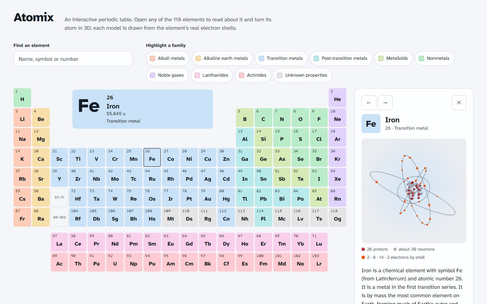
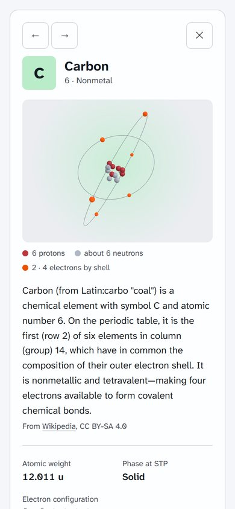
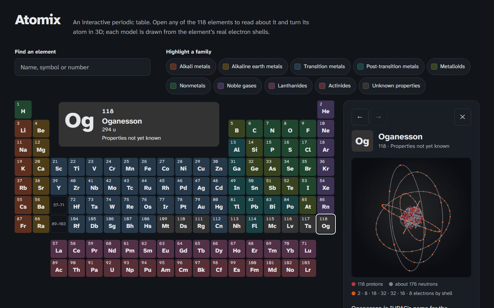

# Atomix

An interactive periodic table. Open any of the 118 elements to read about it and turn a 3D model of its atom, drawn in the browser from the element's real electron shells.

**Live:** https://kalpkj.github.io/Atomix/



## What it does

- **The full table** in the standard 18-column layout, coloured by family. Pointing at an element shows it large in the key above the transition metals.
- **A 3D Bohr model** for every element, made with Three.js: protons and neutrons packed into the nucleus, and each shell's electrons orbiting on a tilted ring. Drag to turn it. Nothing is downloaded; the model is built from the element's shell counts (iron: 2, 8, 14, 2).
- **Search** by name, symbol or number. Matches stay lit, everything else fades, and Enter opens the best match.
- **Family highlighting** from the legend.
- **Keyboard first.** The table is one Tab stop; the arrow keys move between elements and skip the gaps, so all 118 are reachable. Enter opens one.
- **A link for every element**: `#Fe` opens iron.
- **Light and dark** follow your system. With reduced motion turned on, the electrons hold still and the atom stops spinning.

| Phone | Dark |
| --- | --- |
|  |  |

## How it's built

- React 19, TypeScript and Vite, deployed to GitHub Pages by GitHub Actions.
- Three.js loads only when you open an element, so the table itself stays light. The nucleus and the electrons are instanced meshes, so even oganesson (118 protons, about 176 neutrons, 118 electrons) is a handful of draw calls.
- `scripts/build-data.ts` downloads the element data from a pinned commit and trims it to the fields the app uses (`npm run data`).
- Unit tests (Vitest) cover the data, search ranking and arrow-key moves.

The Bohr model is a simplification: electrons don't really travel on rings, and the neutron count is estimated from the rounded atomic weight. The page says so.

## Run it

```bash
npm install
npm run dev      # http://localhost:5173
npm test
npm run build    # static site in dist/
```

## History

Atomix started as a one-day team project on 20 February 2026 by Kalp Joshi ([@KalpKJ](https://github.com/KalpKJ)), Aum Patel and Ohang Patel ([@OhangPatel](https://github.com/OhangPatel)): a Next.js page that showed the table and opened Google's hosted 3D atoms. The current version is a rebuild by Kalp. It replaces the hosted models with atoms drawn from the data, adds search, family highlighting, keyboard navigation and element pages, and moves to Vite. The team's original work is in the history of `main`.

## Credits and licence

- Element data: [Periodic-Table-JSON](https://github.com/Bowserinator/Periodic-Table-JSON) by Bowserinator and contributors.
- Element summaries: Wikipedia, [CC BY-SA 4.0](https://creativecommons.org/licenses/by-sa/4.0/). Each element links to its article.
- Typeface: Atkinson Hyperlegible Next and Mono by the Braille Institute, SIL Open Font License.

The code is MIT licensed (see `LICENSE`). The summaries in `src/data/elements.json` stay under CC BY-SA 4.0.
